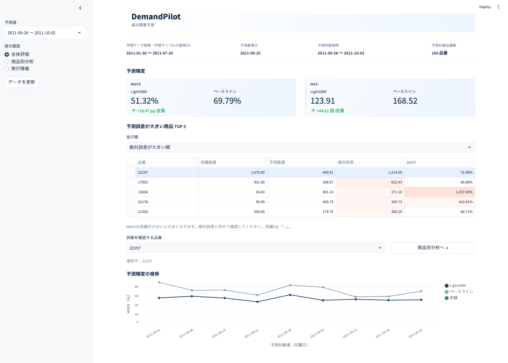
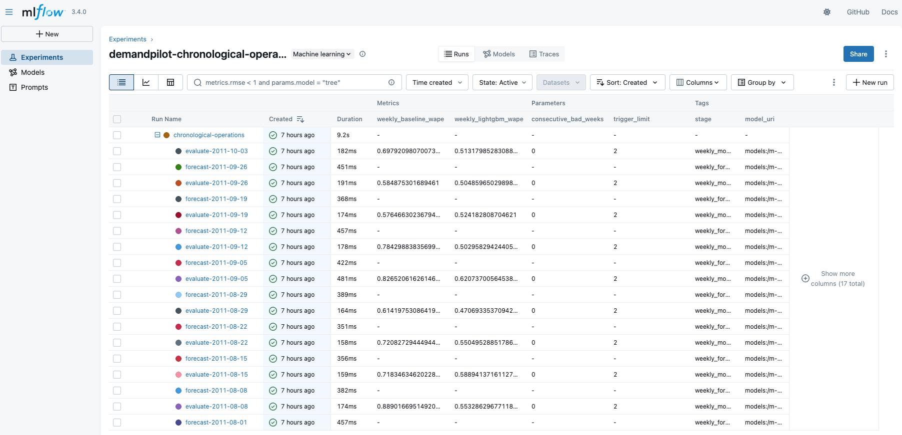
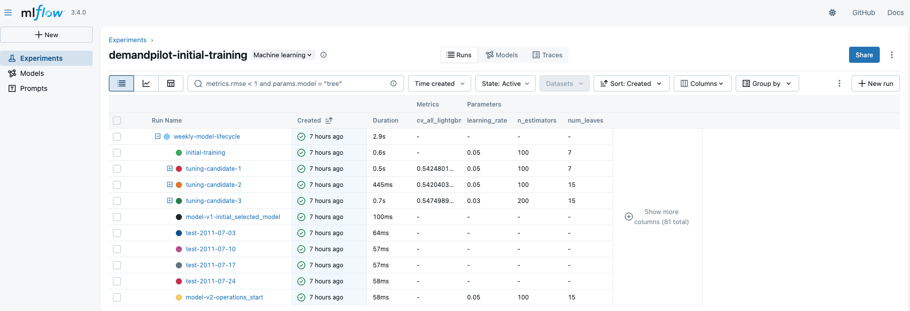
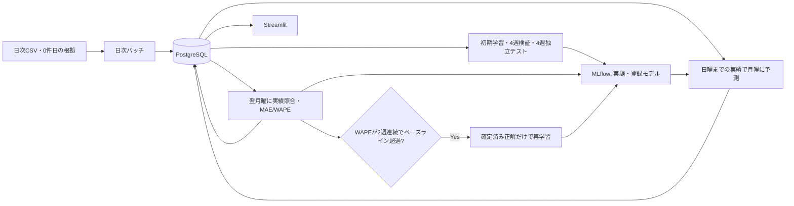

# DemandPilot — 需要予測のデータ基盤・モデル運用

販売データの取り込みから、需要予測モデルの学習、時系列評価、週次監視、条件付き再学習までを過去データで再現するローカルシステム。

**開発目的：** データ処理からモデル開発・評価・運用管理までを一貫して実装し、各工程の再現性とデータ・モデルの追跡可能性を検証する。

予測精度の最大化ではなく、データの時点整合性、処理の再現性、予測・評価・モデル履歴の追跡可能性を重視する。

## 1. 主な機能

- **日次データ処理：** CSVの検証・前処理、取引明細・品番別日次販売のPostgreSQLへの保存
- **データ欠損管理：** 元Excelで確認した取引0件日と、未取り込み・CSV欠落の区別
- **需要予測：** 固定100品番を対象に、LightGBMで翌7日間の販売数量を予測し、直近7日間の販売数量をそのまま翌週の予測値とする単純な手法（ベースライン）と比較する
- **モデル評価：** 週単位のTimeSeriesSplit、独立4週テスト、MAE・WAPEによる精度比較
- **運用監視：** 翌週の実績確定後に精度を評価し、週次WAPEが2週連続でベースラインを上回った場合に再学習する
- **履歴管理：** PostgreSQLとMLflowで予測・評価・使用モデルを追跡する
- **再実行制御：** 二重登録を防止し、中断した処理の再開に対応する
- **可視化：** Streamlitで週別・品番別の予測、実績、誤差、モデル情報を表示する

## 2. 画面イメージ

### Streamlit：需要予測ダッシュボード

週別の予測精度、ベースラインとの比較、誤差の大きい品番、精度の推移を表示する。

### MLflow：週次運用履歴

週ごとの予測・評価RunとWAPE、再学習判定、使用モデルを記録する。

### MLflow：モデル選定履歴

3種類のハイパーパラメータと4週検証WAPEを比較し、モデル選定の履歴を確認する。

## 3. システム構成

日次・週次処理の実行制御は`02_model/weekly/replay.py`に集約する。

データベースは7テーブルで構成し、品番別の確定実績を保存済み予測と同じ行に保持する。モデル更新履歴はMLflowを正本として管理する。

詳細：[システム設計とテーブル構成](05_docs/ARCHITECTURE.md)

## 4. 使用技術と選定理由

| 技術 | 用途・選定理由 |
|---|---|
| Python / pandas / NumPy | CSVの品質確認、日次集計、特徴量・正解データの生成 |
| PostgreSQL / psycopg | トランザクション、主キー・一意制約、COPY、SQL集計によるデータ整合性の確保 |
| Docker Compose | DB・学習処理・MLflow・可視化環境の再現、検証環境の分離 |
| LightGBM / scikit-learn | 表形式データの回帰予測、TimeSeriesSplitを用いた時系列評価 |
| MLflow | 学習条件、評価指標、登録モデル、モデル更新履歴の管理 |
| Streamlit / Altair | 予測・実績・誤差・モデル情報の読み取り専用ダッシュボード |
| pytest | 時点整合性、評価保存の原子性、冪等性、中断再開、モデル切り替えの検証 |

実行環境にはPython 3.12とPostgreSQL 16を使用する。主要な依存ライブラリのバージョンは`requirements.txt`で固定する。

## 5. データ・予測対象・特徴量

### 使用データ

| 項目 | 内容 |
|---|---|
| データセット | [UCI Online Retail](https://archive.ics.uci.edu/dataset/352/online+retail) |
| 概要 | 英国のオンライン小売取引データ |
| 収録期間 | 2010年12月〜2011年12月 |
| 取引件数 | 541,909件 |
| 出典 | Chen, D. (2015). [DOI: 10.24432/C5BW33](https://doi.org/10.24432/C5BW33) |
| ライセンス | CC BY 4.0 |

元Excel、顧客IDを含む取引データ、生成した学習CSV、学習済みモデルはGitHubに含めない。

### 対象品番の選定

- **対象数：** 100品番
- **選定期間：** 2010年12月6日〜2011年5月29日
- **選定条件：** 20週以上の販売実績がある品番から販売数量上位を選定する
- **時点整合性：** 6月以降の情報を使わずに選定し、以降の検証・運用でも対象品番を固定する

### 予測対象と特徴量

**予測対象：** 品番ごとの翌月曜〜日曜の7日間合計販売数量

| 特徴量 | 内容 |
|---|---|
| `sales_sum_7` | 過去7日間の販売数量合計 |
| `sales_sum_28` | 過去28日間の販売数量合計 |
| `sales_std_28` | 過去28日間の販売数量の標本標準偏差 |
| `month` | 予測基準日の月 |
| `stock_code` | カテゴリ型の品番コード |

**ベースライン：** 予測時点の直近7日間の販売数量合計。

既知の共通空白期間を含む履歴・正解データは学習・評価対象から除外する。

## 6. モデルの学習・評価・運用

過去データを時系列順に分け、**モデルの学習 → 性能検証 → 独立テスト → 運用再現**の順番で処理する。

### 6.1 学習・評価の流れ

| 段階 | 使用データ・実施内容 | 目的 |
|---|---|---|
| ① データ準備 | 2010年12月〜2011年7月の販売実績をDBに登録する | 学習・評価用データの準備 |
| ② 初期学習 | 2011年5月31日までに実績が確定したデータでモデルを学習する | 時系列検証の開始時点のモデルを準備 |
| ③ 時系列検証 | 6月の4週間を対象に、各週の予測時点までに確定した実績を使って再学習・評価する | 3種類のパラメータ設定を比較・選定 |
| ④ 独立テスト | 選定済みの設定で7月の4週間を時系列評価する | モデル選定に使用していない期間で予測精度を確認 |
| ⑤ 運用開始モデルの学習 | 選定済みの設定で7月31日までの確定実績を使って学習する | 8月以降の運用に使用するモデルを準備 |

時系列検証では、6月6〜12日、13〜19日、20〜26日、27日〜7月3日の4週間を評価対象とする。

独立テストでは、7月4〜10日、11〜17日、18〜24日、25〜31日の4週間を評価対象とする。選定したハイパーパラメータと学習済みモデルは4週間を通して固定し、週ごとの再学習は行わない。

モデル選定には検証期間の結果だけを使用し、独立テストの結果によるパラメータの再調整は行わない。 品番選定は5月29日までの販売実績で行い、初期学習は5月31日までに正解が確定した学習データを使用する。

モデルの学習には、その時点で販売実績が確定している期間のデータのみを使用し、未来情報の混入を防ぐ。

### 6.2 運用の再現

2011年8月1日〜10月2日の63日間を対象に、実際の日付が進む順番で処理する。

| 処理 | 実施内容 | 実施タイミング |
|---|---|---|
| 日次データ登録 | 当日までの販売実績をDBに保存する | 毎日 |
| 需要予測 | 翌7日間の販売数量を100品番分予測する | 毎週月曜 |
| 精度評価 | 前週の予測と確定した販売実績を比較する | 翌週月曜 |
| 再学習判定 | LightGBMの週次WAPEがベースラインを2週連続で上回ったか確認する | 精度評価後 |
| モデル更新 | 条件に該当した場合、確定済みデータで再学習する | 条件成立時 |

運用再現では、**週次予測9回・精度評価9回**を実行する。

運用再現は9月26日〜10月2日の予測を最後とし、10月3日にその精度を評価して終了する。

## 7. 評価結果と考察

### 選定モデル

| パラメータ | 設定値 |
|---|---|
| `num_leaves` | 15 |
| `learning_rate` | 0.05 |
| `n_estimators` | 100 |

その他の固定条件は学習コードとMLflowに記録する。

### モデル評価結果

| 評価段階 | LightGBM MAE | LightGBM WAPE | ベースライン MAE | ベースライン WAPE |
|---|---:|---:|---:|---:|
| 4週検証 | 127.21 | 54.20% | 165.09 | 70.34% |
| 独立4週テスト | 136.24 | 52.97% | 181.68 | 70.63% |
| 9週の運用再現 | 143.99 | 53.54% | 191.04 | 71.03% |

**MAE：** 品番×週あたりの7日間合計販売数量に対する平均絶対誤差。

**WAPE：** 全絶対誤差合計 ÷ 全実績合計。週別WAPEの単純平均ではなく、評価対象全体を合算して算出する。

### 評価結果の解釈

- **モデル比較：** 4週検証・独立4週テスト・9週の運用再現のすべてでLightGBMがベースラインより小さいWAPEを記録。運用再現では9週間すべてで改善を確認
- **モデル更新：** 実データでは再学習条件に該当せず、再学習は0回
- **再学習機能の検証：** 意図的に精度が悪化する初期モデルを用いた合成データの結合テストで、再学習条件とモデル切り替えを検証した
- **予測精度：** 独立テストのWAPEは52.97%。実業務への導入が可能な精度水準とは判断できない
- **誤差分析：** 欠品、販促、大口注文などの情報がなく、誤差の原因をこの結果だけで特定することはできない
- **評価後の対応：** テスト結果を踏まえた特徴量追加・探索範囲の変更は実施していない

詳細：[評価方法・週別結果](05_docs/EVALUATION.md)

## 8. 実行方法・動作確認

DemandPilotはDocker Composeを使用してローカル環境で実行する。PostgreSQL、Python、MLflow、Streamlitを組み合わせた構成である。

### 実行手順

| 順番 | 処理 | 内容 |
|---|---|---|
| 1 | 環境準備 | Docker環境を構築し、データやモデルの保存先を設定する |
| 2 | データ準備 | 公開データを取得し、日付ごとのCSVファイルを作成する |
| 3 | 初期学習・評価 | データをPostgreSQLに登録し、モデルの学習・検証・独立テストを実行する |
| 4 | 週次運用の再現 | 日次データを順番に登録し、週次予測・精度評価・再学習判定を実行する |
| 5 | 結果確認 | Streamlitで予測・評価結果を、MLflowで学習・モデル履歴を確認する |

具体的な実行コマンドと環境設定は、[ローカル実行手順](05_docs/LOCAL_RUN.md)を参照する。

### 動作検証結果

| 確認項目 | 結果 |
|---|---|
| 自動テスト | pytest 77件成功 |
| 初期学習・評価 | 4週検証・独立4週テストが正常終了 |
| 日次データ処理 | 63日分の登録に成功 |
| 週次予測 | 9週間、合計900件の予測を保存 |
| 週次評価 | 9週間分の精度評価が正常終了 |
| 再学習処理 | 合成データを使用した結合テストで動作確認 |
| 画面表示 | Streamlit・MLflowのブラウザ表示を確認 |

上記の動作検証は、既存データベースから分離したローカル環境で実施した。

## 9. 実用化に向けた制約

DemandPilotは、過去データを用いて需要予測モデルの運用工程を再現するためのシステムである。実際の業務で継続的に利用するには、以下の課題が残る。

### 未実装の機能

| 項目 | 現状と課題 |
|---|---|
| 運用の自動化 | 日次・週次処理は手動実行。スケジューラによる自動実行は未実装 |

### 未検証・検証上の課題

| 項目 | 現状と課題 |
|---|---|
| クラウド運用 | ローカルのDocker環境でのみ動作検証済み。クラウド環境での運用は未検証 |
| 予測精度 | 独立テストのWAPEは52.97%。業務利用に十分な精度かは未判断 |
| データの制約 | 欠品・販促・大口注文等の情報がなく、販売数量の変動要因を十分に考慮できない |
| モデル更新 | 再学習処理は動作確認済み。ただし、実データでの再学習後の予測精度は未評価 |
| 汎化性能 | 単一の公開データセットで検証しており、異なる商品・期間・企業への適用可能性は未確認 |

在庫補充や自動発注は本プロジェクトの対象外とする。

## 10. 詳細資料

| 資料 | 内容 |
|---|---|
| [LOCAL_RUN.md](05_docs/LOCAL_RUN.md) | ローカル環境構築、データ準備、実行・テスト手順 |
| [ARCHITECTURE.md](05_docs/ARCHITECTURE.md) | システム設計、7テーブル構成、再実行・モデル履歴の管理 |
| [EVALUATION.md](05_docs/EVALUATION.md) | モデル評価方法、週別結果、評価上の制約 |
