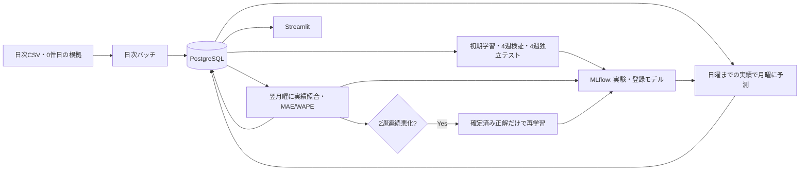

# DemandPilot — 需要予測のデータ基盤・モデル運用

販売データの取り込みから、需要予測モデルの学習、時系列評価、週次監視、条件付き再学習までを、過去データで再現するローカルシステムです。

データサイエンティストへの転職に向け、**データ処理とモデル管理・運用を自分で設計・実装し、その判断理由を説明すること**を目的に開発しました。予測精度の最大化ではなく、時点を守った処理、実行の再現、履歴の追跡を重視しています。

## 主な機能

- 日次CSVの検証・前処理と、PostgreSQLへの明細・商品別日次販売の保存
- 元Excelで確認した取引0件日と、未取り込み・CSV欠落の区別
- 固定100品番の翌7日間の販売数量をLightGBMと直近7日ベースラインで予測
- 週を単位とするTimeSeriesSplit、独立4週テスト、MAE・WAPEによる評価
- 翌週の実績確定後の監視と、2週連続でベースラインより悪化した場合だけ再学習
- PostgreSQLとMLflowによる予測・評価・使用モデルの追跡、冪等な再実行と中断再開
- Streamlitで週別の予測・実績・精度、商品別の誤差、モデル情報を表示

## システム構成

日次と週次の制御は`02_model/weekly/replay.py`へ集約しています。DBは7テーブルです。モデル更新の正本はMLflow、商品別の確定実績は保存済み予測と同じ行に保持します。[設計とテーブルの役割](05_docs/ARCHITECTURE.md)

## 技術と選定理由

| 技術 | 用途・選定理由 |
|---|---|
| Python / pandas / NumPy | CSVの品質確認、日次から特徴量・正解への変換を明示的に記述 |
| PostgreSQL / psycopg | トランザクション、主キー・一意制約、COPYとSQL集計で整合性を保つ |
| Docker Compose | DB・学習処理・MLflow・画面を同じ環境で再現し、検証環境を分離 |
| LightGBM / scikit-learn | 表形式データの回帰とTimeSeriesSplit。小さな固定探索で説明しやすくする |
| MLflow | 入力、条件、各週の指標、登録モデル、更新理由を対応付ける |
| Streamlit / Altair | 予測・実績・誤差とモデルの記録を、DBを更新せず閲覧 |
| pytest | 未来情報の拒否、評価保存の原子性、冪等性、中断再開、モデル切替を確認 |

主要依存は`requirements.txt`でバージョンを固定しています。Python 3.12・PostgreSQL 16を使用します。

## データ・予測対象・特徴量

出典は[UCI Online Retail](https://archive.ics.uci.edu/dataset/352/online+retail)。英国のオンライン小売の2010年12月〜2011年12月の取引541,909件です。Chen, D. (2015), DOI: [10.24432/C5BW33](https://doi.org/10.24432/C5BW33)。データのライセンスはCC BY 4.0です。元Excel・顧客IDを含む取引・学習CSV・モデルはGitに含めません。

対象100品番は、**2010年12月6日〜2011年5月29日だけ**を使い、20週以上販売のあった品番から数量上位で固定します。6月以降の成績で選び直しません。

予測単位は品番ごとの翌月曜〜日曜の7日合計です。特徴量は基準日の日曜までの過去7日合計、28日合計、28日の標本標準偏差、月、カテゴリ型の品番です。ベースラインは予測時に保存した直近7日合計です。既知の共通空白期間を含む履歴・正解は除外します。

## 学習・検証・独立テスト

| 段階 | 期間・扱い |
|---|---|
| 初期DB登録 | 2010-12-01〜2011-07-31 |
| 初期学習 | 5月31日までに確定した正解。28日履歴・週ラベルの条件を満たす行だけを使用 |
| 時系列検証 | 6/5・12・19・26を予測基準日とする4Fold。各週100品番をまとめて分割 |
| 選定 | 既存3候補の全検証週を合算したWAPEが最小の条件 |
| 独立テスト | 7/4〜7/31の4週。7/3までの確定ラベルで学習したモデル・条件を固定 |
| 運用開始モデル | テスト後、選定済み条件で7/31までの確定ラベルを使って学習 |
| 運用再現 | 8/1〜10/2の63日。月曜予測9回、翌月曜評価9回。最後は10/3に評価のみ |

検証の最後の対象週は6/27〜7/3です。モデル選定後のテスト対象は7/4以降なので、対象期間は重なりません。各学習時点では`target_end <= cutoff`を守ります。

## 評価結果と考察

選定条件は`num_leaves=15, learning_rate=0.05, n_estimators=100`です。他の固定条件は学習コードとMLflowに記録します。

| 評価段階 | LightGBM MAE | WAPE | ベースライン MAE | WAPE |
|---|---:|---:|---:|---:|
| 4週検証 | 127.21 | 54.20% | 165.09 | 70.34% |
| 独立4週テスト | 136.24 | 52.97% | 181.68 | 70.63% |
| 9週の運用再現 | 143.99 | 53.54% | 191.04 | 71.03% |

MAEは品番×週あたりの7日合計数量に対する誤差、WAPEは全誤差合計÷全実績合計です。週別WAPEの単純平均ではありません。

今回の9週はすべてLightGBMのWAPEがベースラインより小さく、**実データでの再学習は0回**でした。更新条件と更新後モデルの使用は、意図的に外れる初期モデルを使った合成データの結合テストで検証しています。

ベースラインより改善していますが、独立テストのWAPEは52.97%であり、実務導入可能な精度と判断できる結果ではありません。欠品・販促・大口注文などの情報がなく、誤差の原因をこの比較だけで断定できません。結果を見て特徴量や探索範囲を追加していません。[週別結果・評価の範囲](05_docs/EVALUATION.md)

## 実行・テスト

DockerとDocker Compose、UCIから取得した元Excelが必要です。初回環境は次の順序で実行します。

1. 未使用のComposeプロジェクト名と、データ・MLflow・成果物の保存先を指定する。
2. 元Excelを日次CSVへ分割し、取引0件日を根拠付きで準備する。
3. `python -m weekly.replay --mode initial`で初期登録・学習・検証・テストを実行する。
4. 初期処理が保存した登録バージョンを指定し、`python -m weekly.replay --mode operations --initial-model-version "$INITIAL_MODEL_VERSION"`を実行する。
5. `pytest -q 04_tests`で検証し、MLflow・Streamlitを起動する。

すべてDocker内のコマンドです。コピー可能なコマンドと再起動方法は[実行手順](05_docs/LOCAL_RUN.md)にまとめています。画面の接続先は`docker compose ps`で確認できます。ポートは`DASHBOARD_PORT`と`MLFLOW_PORT`で変更できます。

## 制約・未実装

- 手動実行の過去データシミュレーションです。自動スケジューラ・クラウド配信は構築していません。
- 予測は実売数量であり、欠品による潜在需要を推定しません。在庫補充・自動発注機能はありません。
- 実データで再学習が発生しなかったため、更新後モデルの運用成績は未取得です。
- 品番別の販売なしと欠品は区別できません。取引0件日と未取り込みは処理台帳で区別します。
- 任意期間への拡張や、予測済み期間の実績訂正を上書きする運用は対象外です。
- 旧9テーブルDBをそのまま新コードへ切り替える移行は行いません。新規DBで再現し、旧DB・MLflowは保存します。
- 同じ過去データセットの結果を既に確認しているため、実運用・別データでの一般化は未検証です。

## 詳細資料

- [実行・テスト・データ準備](05_docs/LOCAL_RUN.md)
- [設計、7テーブル、再開とモデル履歴](05_docs/ARCHITECTURE.md)
- [評価方法と週別の結果](05_docs/EVALUATION.md)
